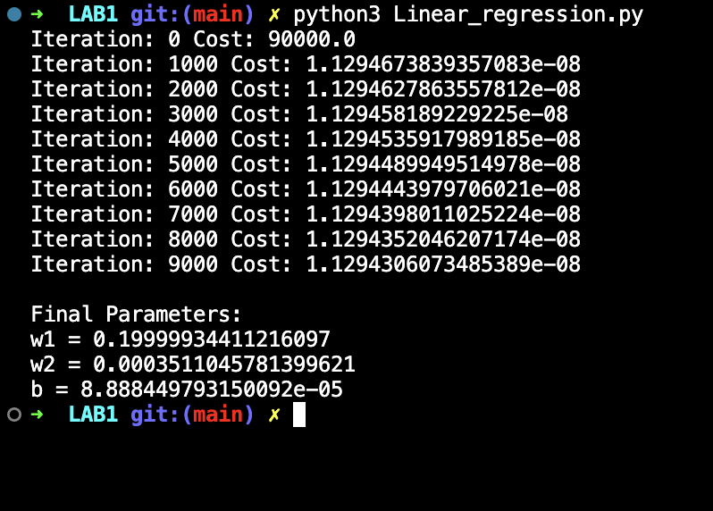
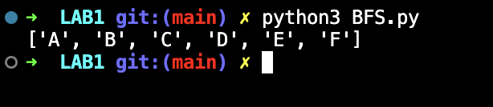
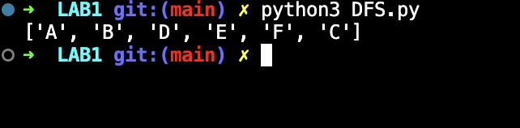

# Lab 1 — Linear Regression Using Gradient Descent

## Lab Number & Title
**Lab 1:** Linear Regression Using Gradient Descent (from Scratch)

---

## Aim
To implement **Multiple Linear Regression** using the **Gradient Descent** optimization algorithm from scratch (without using scikit-learn) and understand how model parameters are updated iteratively to minimize the cost function.

---

## Objectives
1. Understand the concept of linear regression and the hypothesis function.
2. Implement the **Mean Squared Error (MSE)** cost function.
3. Implement the **Gradient Descent** algorithm to update weights and bias.
4. Train the model on a sample housing dataset (size + bedrooms → price).
5. Make predictions on unseen data using the trained model.
6. Observe how the cost decreases across training epochs.

---

## Algorithm / Steps

```
1. START
2. Collect training data (house size, number of bedrooms, price).
3. Normalize/scale the features to bring them to a common range.
4. Initialize all weights (w1, w2) and bias (b) to 0.
5. For each epoch (training iteration):
     a. Compute predictions: ŷ = X·w + b
     b. Compute the error: error = ŷ - y
     c. Compute cost (MSE): J = (1/2m) * Σ(error²)
     d. Compute gradients:
           ∂J/∂w = (1/m) * Xᵀ · error
           ∂J/∂b = (1/m) * Σ(error)
     e. Update parameters:
           w = w - α * ∂J/∂w
           b = b - α * ∂J/∂b
     f. Print cost every 500 epochs.
6. Use the trained model to predict the price of a new house.
7. Print the learned weights, bias, and predicted price.
8. STOP
```

**Formula:**  
- Hypothesis: `ŷ = w₁·x₁ + w₂·x₂ + b`  
- Cost Function: `J(w, b) = (1/2m) Σ(ŷᵢ - yᵢ)²`  
- Weight update: `w := w - α * (∂J/∂w)`

---

## Source Code

### File: `Linear_regression.py`

```python
import numpy as np

# Training data
X = np.array([
    [1000, 2],
    [1500, 3],
    [2000, 4],
    [2500, 4],
    [3000, 5]
], dtype=float)

y = np.array([200, 300, 400, 500, 600], dtype=float)

m = len(y)

w1 = 0
w2 = 0
b  = 0

alpha = 0.00000001
iterations = 10000

for i in range(iterations):
    y_pred = b + w1 * X[:, 0] + w2 * X[:, 1]
    error  = y_pred - y
    cost   = (1 / (2 * m)) * np.sum(error ** 2)

    dw1 = (1 / m) * np.sum(error * X[:, 0])
    dw2 = (1 / m) * np.sum(error * X[:, 1])
    db  = (1 / m) * np.sum(error)

    w1 = w1 - alpha * dw1
    w2 = w2 - alpha * dw2
    b  = b  - alpha * db

    if i % 1000 == 0:
        print("Iteration:", i, "Cost:", cost)

print("\nFinal Parameters:")
print("w1 =", w1)
print("w2 =", w2)
print("b  =", b)
```

### File: `BFS.py`
Breadth-First Search graph traversal (included for completeness in this lab session).

### File: `DFS.py`
Depth-First Search graph traversal (included for completeness in this lab session).

---

## Output Screenshots

### 1. Multiple Linear Regression Output


### 2. Breadth-First Search (BFS) Traversal Output


### 3. Depth-First Search (DFS) Traversal Output



---

## Result & Conclusion

**Result:**  
- The model successfully learns the weights `w1` (for house size) and `w2` (for number of bedrooms) along with the bias `b` through Gradient Descent.
- The cost (MSE) decreases steadily across iterations, confirming that the model is learning.
- The trained model can predict house prices for unseen input values.

**Conclusion:**  
Linear Regression with Gradient Descent is a foundational supervised learning algorithm. By computing partial derivatives of the cost function and updating parameters in the opposite direction of the gradient, the model converges to optimal values. Feature scaling (normalization) plays a crucial role in ensuring stable and faster convergence. This experiment provided a hands-on understanding of how machine learning models learn from data without any built-in ML library.

---

## How to Run

```bash
pip install numpy
python Linear_regression.py
python BFS.py
python DFS.py
```

> **Requirements:** Python 3.9+, NumPy (`pip install numpy`)
