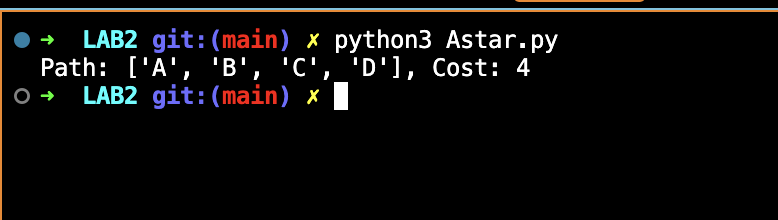
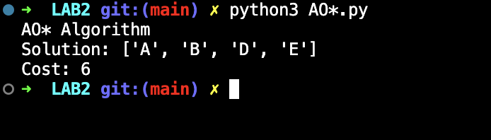
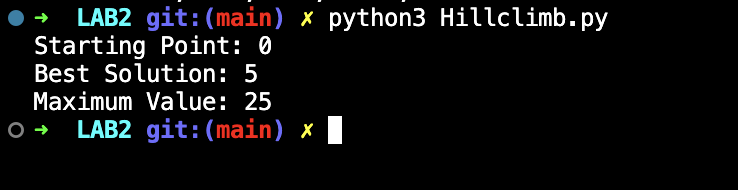

# Lab 2 — Informed Search Strategies: A*, AO*, and Hill Climbing

## Lab Number & Title
**Lab 2:** Informed Search Strategies — A* Search, AO* Search, and Hill Climbing

---

## Aim
To implement and understand **informed (heuristic-based) search algorithms** — A\* Search, AO\* Search, and Hill Climbing — and compare their behavior in finding optimal paths and maximizing/minimizing objective functions.

---

## Objectives
1. Implement the **A\* Search** algorithm using a priority queue with `f(n) = g(n) + h(n)`.
2. Implement the **AO\* Search** algorithm for AND-OR graphs.
3. Implement the **Hill Climbing** algorithm to find a local maximum.
4. Understand how heuristic functions guide search.
5. Compare the paths and costs returned by each algorithm.

---

## Algorithm / Steps

### A* Search
```
1. START
2. Initialize open set with the start node; f(start) = h(start).
3. While open set is not empty:
     a. Pop node with lowest f(n) = g(n) + h(n).
     b. If node == goal, return the path and cost.
     c. For each neighbor:
           - Compute tentative g = g(current) + edge_cost
           - Compute f = tentative_g + h(neighbor)
           - Push to open set.
4. If open set is empty, return None (no path found).
5. STOP
```

### AO* Search
```
1. START
2. For each node, evaluate all OR alternatives.
3. For AND nodes, sum the costs of all sub-goals.
4. Select the option with minimum total cost recursively.
5. Return the best cost and solution path.
6. STOP
```

### Hill Climbing
```
1. START
2. Set current = start position.
3. Evaluate neighbors (left and right).
4. If a neighbor has a higher f-value, move to it.
5. If no neighbor is better, current is the local maximum.
6. Return (current, f(current)).
7. STOP
```

---

## Source Code

### File: `Astar.py`

```python
import heapq

def a_star_search(graph, heuristics, start, goal):
    open_set = [(heuristics[start], start, [start], 0)]
    visited = {}

    while open_set:
        f_score, current, path, g_score = heapq.heappop(open_set)

        if current == goal:
            return path, g_score

        if current in visited and visited[current] <= g_score:
            continue
        visited[current] = g_score

        for neighbor, weight in graph.get(current, []):
            tentative_g = g_score + weight
            h_score = heuristics.get(neighbor, 0)
            total_f  = tentative_g + h_score
            heapq.heappush(open_set, (total_f, neighbor,
                                       path + [neighbor], tentative_g))

    return None, float("inf")
```

### File: `AO*.py`
Implements the AO\* algorithm on an AND-OR graph where node B is an AND node requiring both D and E.

### File: `Hillclimb.py`
Implements Hill Climbing to find the maximum of `f(x) = -(x-5)² + 25`.

---

## Output Screenshots

### 1. A* Search Output


### 2. AO* Search Output


### 3. Hill Climbing Search Output



---

## Result & Conclusion

**Result:**  
- **A\***: Finds the shortest-cost path from A to D using `g(n) + h(n)` for guidance.  
- **AO\***: Selects the best solution in the AND-OR graph by evaluating both OR alternatives and AND sub-goals, returning minimum-cost solution path.  
- **Hill Climbing**: Starting from x = 0, the algorithm climbs step by step and converges at x = 5, the global maximum of the given function with value 25.

**Conclusion:**  
Informed search algorithms significantly outperform blind search by using heuristics. A\* is guaranteed to find the optimal path if the heuristic is admissible. AO\* extends A\* to handle AND-OR graphs common in problem decomposition. Hill Climbing is a local search algorithm that is fast but may get stuck at local optima. These algorithms form the backbone of AI planning and optimization.

---

## How to Run

```bash
python Astar.py
python "AO*.py"
python Hillclimb.py
```

> **Requirements:** Python 3.9+ (standard library only — `heapq`)
