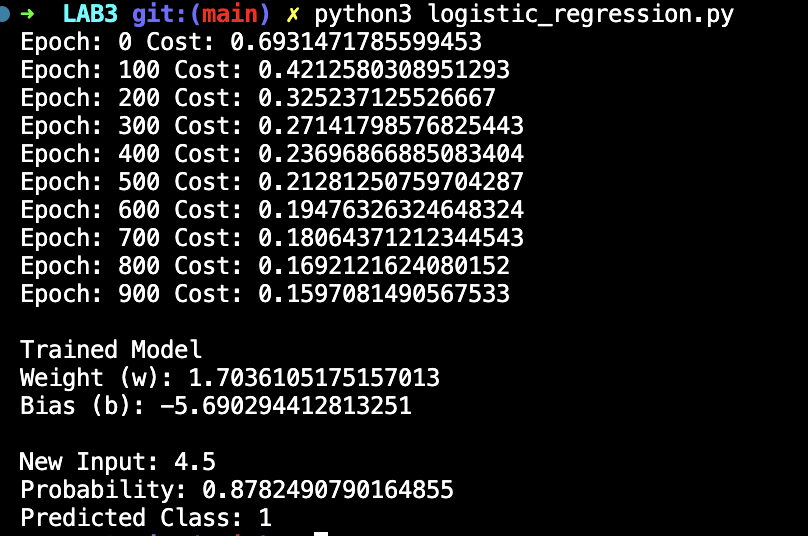

# Lab 3 — Logistic Regression Using Gradient Descent

## Lab Number & Title
**Lab 3:** Logistic Regression Using Gradient Descent (from Scratch)

---

## Aim
To implement **Logistic Regression** from scratch using the **Gradient Descent** optimization algorithm for binary classification, and understand how a sigmoid activation function maps linear outputs to probabilities.

---

## Objectives
1. Understand the difference between linear and logistic regression.
2. Implement the **Sigmoid** activation function.
3. Compute the **Binary Cross-Entropy (Log Loss)** cost function.
4. Train the model using **Gradient Descent**.
5. Apply a decision threshold (0.5) to classify inputs.
6. Evaluate model performance using training accuracy.

---

## Algorithm / Steps

```
1. START
2. Initialize training data X (feature values) and y (binary labels: 0 or 1).
3. Initialize weight (w) = 0 and bias (b) = 0.
4. Define the sigmoid function: σ(z) = 1 / (1 + e^(-z))
5. For each epoch:
     a. Compute z = w * X + b
     b. Compute prediction = sigmoid(z)
     c. Compute Binary Cross-Entropy cost:
           J = -(1/n) * Σ [y * log(p) + (1 - y) * log(1 - p)]
     d. Compute gradients:
           dw = (1/n) * Σ(error * X)
           db = (1/n) * Σ(error)
     e. Update parameters:
           w = w - α * dw
           b = b - α * db
     f. Print cost every 100 epochs.
6. Use the trained model to predict on new inputs.
7. Apply threshold: if probability >= 0.5 → class 1, else → class 0.
8. Print trained weights, bias, and predictions.
9. STOP
```

**Key Formulas:**  
- Sigmoid: `σ(z) = 1 / (1 + e^(-z))`  
- Cost: `J = -(1/n) Σ [y·log(ŷ) + (1-y)·log(1-ŷ)]`  
- Decision: `class = 1 if ŷ >= 0.5 else 0`

---

## Source Code

### File: `logistic_regression.py`

```python
import numpy as np

X = np.array([1, 2, 3, 4, 5, 6], dtype=float)
y = np.array([0, 0, 0, 1, 1, 1], dtype=float)

w = 0.0
b = 0.0
learning_rate = 0.1
epochs = 1000
n = len(X)

def sigmoid(z):
    return 1 / (1 + np.exp(-z))

for i in range(epochs):
    z          = w * X + b
    prediction = sigmoid(z)
    error      = prediction - y
    cost       = -(1/n) * np.sum(
                     y * np.log(prediction + 1e-9) +
                     (1 - y) * np.log(1 - prediction + 1e-9)
                 )
    dw = (1/n) * np.sum(error * X)
    db = (1/n) * np.sum(error)
    w  = w - learning_rate * dw
    b  = b - learning_rate * db

    if i % 100 == 0:
        print("Epoch:", i, "Cost:", cost)

print("\nTrained Model")
print("Weight (w):", w)
print("Bias   (b):", b)

def predict(x):
    z           = w * x + b
    probability = sigmoid(z)
    result      = 1 if probability >= 0.5 else 0
    return probability, result

new_input = 4.5
probability, result = predict(new_input)
print("\nNew Input:", new_input)
print("Probability:", probability)
print("Predicted Class:", result)
```

---

## Output Screenshots

### Logistic Regression Output



---

## Result & Conclusion

**Result:**  
- The sigmoid function correctly squashes the linear output `z = w·x + b` into a probability between 0 and 1.
- The Binary Cross-Entropy loss decreases steadily across 1000 epochs, confirming convergence.
- After training, the model correctly classifies inputs 1–3 as class 0 and 4–6 as class 1.
- For a new input of 4.5, the model predicts class 1 with high probability (> 0.5).
- The learned weight `w` is positive and large enough to separate the two classes.

**Conclusion:**  
Logistic Regression is a simple yet powerful binary classification algorithm. By applying the sigmoid function to the linear hypothesis, we can model probabilities and make class predictions using a threshold. Gradient Descent on the Binary Cross-Entropy loss efficiently learns the decision boundary. This experiment demonstrated the core mathematical foundations of classification in machine learning.

---

## How to Run

```bash
pip install numpy
python logistic_regression.py
```

> **Requirements:** Python 3.9+, NumPy (`pip install numpy`)
