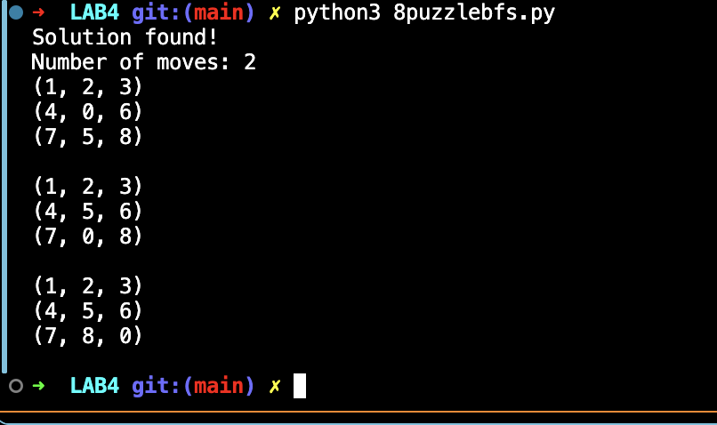
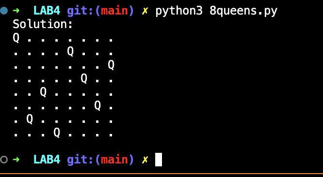
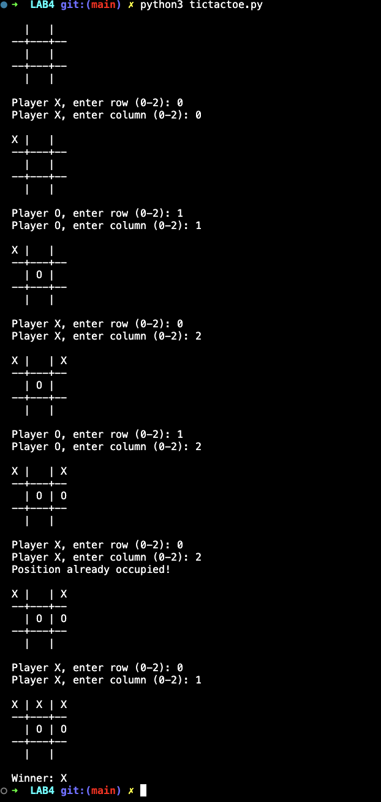

# Lab 4 — Search Strategies: 8-Puzzle, 8-Queens & Tic-Tac-Toe

## Lab Number & Title
**Lab 4:** Search Strategies for Classic AI Problems — 8-Puzzle (BFS), 8-Queens (Backtracking), and Tic-Tac-Toe (Minimax)

---

## Aim
To model and solve **classic Artificial Intelligence problems** as state-space search problems using appropriate search strategies — BFS for the 8-Puzzle, recursive Backtracking for the 8-Queens problem, and Minimax for Tic-Tac-Toe.

---

## Objectives
1. Model each problem as a state-space with initial state, goal condition, and legal operators.
2. Solve the **8-Puzzle** using **Breadth-First Search (BFS)** to find the minimum number of moves.
3. Solve the **8-Queens Problem** using **Backtracking** (depth-first search with constraint checking).
4. Choose the best move in **Tic-Tac-Toe** using the **Minimax algorithm**.
5. Understand the trade-offs of uninformed vs. game-tree search.

---

## Algorithm / Steps

### 8-Puzzle — BFS
```
1. START
2. Represent the board as a flat tuple of 9 numbers (0 = blank).
3. Initialize BFS queue with the start state.
4. While queue is not empty:
     a. Dequeue a state.
     b. If state == goal, reconstruct and return the path.
     c. Find the blank tile position.
     d. Generate all legal neighbor states (slide tiles up/down/left/right).
     e. For each unvisited neighbor, enqueue it.
5. STOP
```

### 8-Queens — Backtracking
```
1. START
2. Try to place a queen in each column one by one.
3. For column c, try all rows r:
     a. Check if placing a queen at (r, c) is safe:
        - No queen in the same row.
        - No queen on the same diagonal.
     b. If safe, place the queen and recurse to column c+1.
     c. If recursion fails, remove the queen (backtrack).
4. If all 8 queens are placed, return the solution.
5. STOP
```

### Tic-Tac-Toe — Minimax
```
1. START
2. Check terminal state: win for X (+1), win for O (−1), draw (0).
3. If maximizing (X's turn):
     - Try all empty cells, place X, recurse with minimizing.
     - Choose the move with the highest score.
4. If minimizing (O's turn):
     - Try all empty cells, place O, recurse with maximizing.
     - Choose the move with the lowest score.
5. Return the best move index.
6. STOP
```

---

## Source Code

### File: `8puzzlebfs.py`
Solves the 8-Puzzle using BFS; prints each state step in the solution path.

### File: `8queens.py`
Solves the 8-Queens problem using recursive backtracking; prints the board with Q markers.

### File: `tictactoe.py`
Interactive Tic-Tac-Toe game: human plays as X, computer plays as O using Minimax.

```python
# Snippet: Minimax Core (tictactoe.py)
def minimax(board, maximizing):
    winner = check_winner(board)
    if winner == "O": return  1
    if winner == "X": return -1
    if is_full(board):  return  0

    if maximizing:
        best = -100
        for i in range(3):
            for j in range(3):
                if board[i][j] == " ":
                    board[i][j] = "O"
                    best = max(best, minimax(board, False))
                    board[i][j] = " "
        return best
    else:
        best = 100
        for i in range(3):
            for j in range(3):
                if board[i][j] == " ":
                    board[i][j] = "X"
                    best = min(best, minimax(board, True))
                    board[i][j] = " "
        return best
```

---

## Output Screenshots

### 1. 8-Puzzle BFS Output


### 2. 8-Queens Backtracking Output


### 3. Tic-Tac-Toe Minimax Output



---

## Result & Conclusion

**Result:**  
- **8-Puzzle**: BFS successfully finds the minimum number of moves to reach the goal state from the start. The solution path is printed step by step.  
- **8-Queens**: Backtracking finds a valid placement of 8 non-attacking queens on an 8×8 board and displays the board with Q markers.  
- **Tic-Tac-Toe**: The Minimax algorithm always selects the optimal move for the computer (O), making it unbeatable. The computer either wins or forces a draw.

**Conclusion:**  
These three problems demonstrate different state-space search paradigms. BFS guarantees shortest-path optimality for the 8-Puzzle. Backtracking efficiently prunes the search space for constraint satisfaction (8-Queens). Minimax builds the complete game tree to determine the optimal strategy in adversarial settings. Together, they showcase the breadth of classical AI search techniques.

---

## How to Run

```bash
python 8puzzlebfs.py
python 8queens.py
python tictactoe.py   # Interactive — enter row and column when prompted
```

> **Requirements:** Python 3.9+ (standard library only — `collections.deque`)
