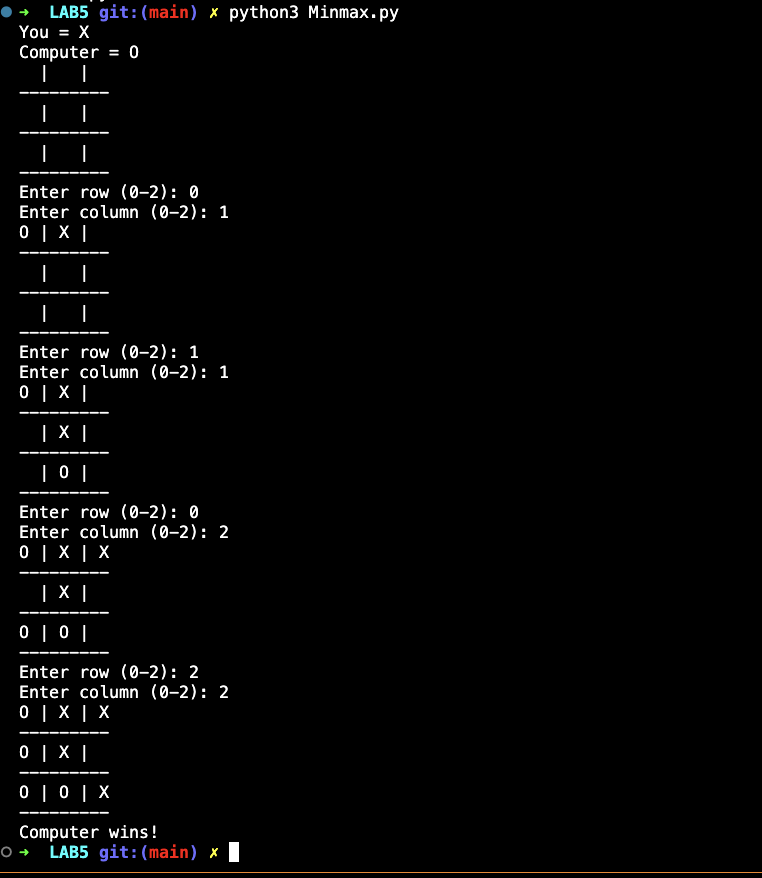

# Lab 5 — Minimax Algorithm for Game Playing

## Lab Number & Title
**Lab 5:** Minimax Algorithm for Optimal Decision Making in Two-Player Games

---

## Aim
To implement the **Minimax Algorithm** for a two-player, zero-sum game (Tic-Tac-Toe) and determine the **optimal move** for the current player by exhaustively evaluating the game tree.

---

## Objectives
1. Represent a Tic-Tac-Toe game state as a list of 9 cells.
2. Identify the **MAX** player (X) and **MIN** player (O).
3. Define utility values for terminal states: +1 (X wins), −1 (O wins), 0 (draw).
4. Implement recursive Minimax to evaluate the full game tree.
5. Select and apply the move with the best minimax score.
6. Visualize the board before and after the optimal move.

---

## Algorithm / Steps

```
1. START
2. Represent the board as a list of 9 elements (' ', 'X', or 'O').
3. Define terminal check: check all rows, columns, and diagonals.
4. Define minimax(board, maximizing):
     a. If X wins → return score = +1
     b. If O wins → return score = −1
     c. If draw   → return score = 0
     d. If maximizing (X's turn):
           best_score = -∞
           For each empty cell:
               Place X, recurse with maximizing = False
               Update best_score = max(best_score, score)
               Record best move index
           Return (best_score, best_move)
     e. If minimizing (O's turn):
           best_score = +∞
           For each empty cell:
               Place O, recurse with maximizing = True
               Update best_score = min(best_score, score)
               Record best move index
           Return (best_score, best_move)
5. Call minimax on the current board state (X to move).
6. Apply the returned best move to the board.
7. Display the board before and after the move.
8. STOP
```

**Key Concepts:**  
- **MAX player (X)** tries to maximize the score.  
- **MIN player (O)** tries to minimize the score.  
- The algorithm explores every possible future game state (full game tree).

---

## Source Code

### File: `Minmax.py`

```python
def print_board(board):
    for row in board:
        print(" | ".join(row))
        print("-" * 9)

def check_winner(board):
    # Rows
    for row in board:
        if row[0] == row[1] == row[2] and row[0] != " ":
            return row[0]
    # Columns
    for col in range(3):
        if board[0][col] == board[1][col] == board[2][col] and board[0][col] != " ":
            return board[0][col]
    # Diagonals
    if board[0][0] == board[1][1] == board[2][2] and board[0][0] != " ":
        return board[0][0]
    if board[0][2] == board[1][1] == board[2][0] and board[0][2] != " ":
        return board[0][2]
    return None

def is_full(board):
    return all(board[i][j] != " " for i in range(3) for j in range(3))

def minimax(board, maximizing):
    winner = check_winner(board)
    if winner == "O": return  1
    if winner == "X": return -1
    if is_full(board): return  0

    if maximizing:
        best_score = -100
        for i in range(3):
            for j in range(3):
                if board[i][j] == " ":
                    board[i][j] = "O"
                    score = minimax(board, False)
                    board[i][j] = " "
                    best_score = max(best_score, score)
        return best_score
    else:
        best_score = 100
        for i in range(3):
            for j in range(3):
                if board[i][j] == " ":
                    board[i][j] = "X"
                    score = minimax(board, True)
                    board[i][j] = " "
                    best_score = min(best_score, score)
        return best_score

def best_move(board):
    best_score = -100
    move = None
    for i in range(3):
        for j in range(3):
            if board[i][j] == " ":
                board[i][j] = "O"
                score = minimax(board, False)
                board[i][j] = " "
                if score > best_score:
                    best_score = score
                    move = (i, j)
    return move

def play_game():
    board = [[" " for _ in range(3)] for _ in range(3)]
    print("You = X | Computer = O")
    while True:
        print_board(board)
        row = int(input("Enter row (0-2): "))
        col = int(input("Enter column (0-2): "))
        if board[row][col] != " ":
            print("Invalid move!")
            continue
        board[row][col] = "X"
        if check_winner(board) == "X":
            print_board(board)
            print("You win!")
            break
        if is_full(board):
            print_board(board)
            print("Draw!")
            break
        move = best_move(board)
        if move:
            board[move[0]][move[1]] = "O"
        if check_winner(board) == "O":
            print_board(board)
            print("Computer wins!")
            break
        if is_full(board):
            print_board(board)
            print("Draw!")
            break

play_game()
```

---

## Output Screenshots

### Minimax Game Playing Output



---

## Result & Conclusion

**Result:**  
- The Minimax algorithm correctly evaluates the game tree and always picks the **optimal move** for the computer (O).  
- The computer is **unbeatable**: it always either wins or forces a draw when playing optimally.  
- Terminal states are assigned correct utility values (+1, −1, 0) and the recursion correctly propagates these values up through the tree.  
- The interactive game loop allows the human player (X) to play against the Minimax AI.

**Conclusion:**  
Minimax is a cornerstone algorithm in game-playing AI. By recursively exploring all possible future states and selecting the move that maximizes/minimizes the outcome, it guarantees optimal play in deterministic, two-player, zero-sum games. This experiment reinforced the concept of the **game tree**, utility functions, and the recursive nature of Minimax. Extensions such as **Alpha-Beta Pruning** can significantly reduce computation by pruning branches that cannot affect the final decision.

---

## How to Run

```bash
python Minmax.py
```

> **Requirements:** Python 3.9+ (standard library only — no external packages needed)  
> When prompted, enter row and column as integers (0, 1, or 2).
