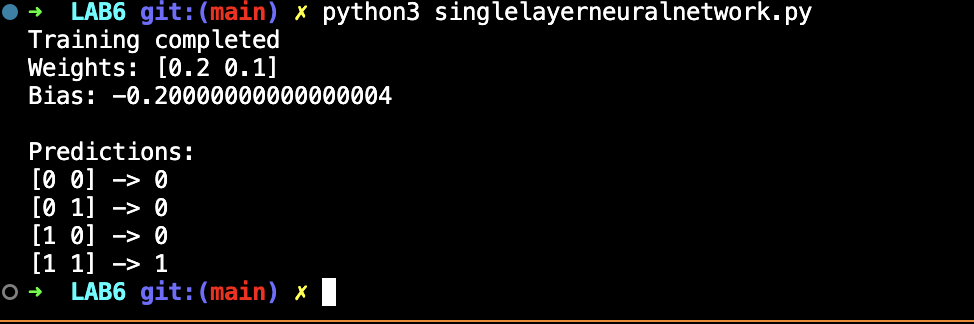

# Lab 6 — Single-Layer Neural Network (Perceptron)

## Lab Number & Title
**Lab 6:** Single-Layer Neural Network — Perceptron Learning Algorithm

---

## Aim
To implement a **Single-Layer Neural Network (Perceptron)** from scratch and train it using the **Perceptron Learning Rule** for binary classification on the AND logic gate.

---

## Objectives
1. Understand the structure and working of a Perceptron.
2. Initialize weights and bias to zero.
3. Compute the **weighted sum** and apply a **step activation function**.
4. Apply the **Perceptron Learning Rule** to update weights based on error.
5. Train the network until all inputs are classified correctly (zero mistakes).
6. Test the trained Perceptron on all AND gate inputs.

---

## Algorithm / Steps

```
1. START
2. Define training data X (AND gate inputs) and labels y (expected outputs).
3. Initialize weights w = [0.0, 0.0] and bias b = 0.
4. Set learning rate α = 0.1 and number of epochs.
5. For each epoch:
     a. mistakes = 0
     b. For each training sample (xᵢ, yᵢ):
           i.  Compute weighted sum: z = Σ(wⱼ · xᵢⱼ) + b
           ii. Apply step activation: ŷ = 1 if z >= 0, else 0
           iii. Compute error: e = yᵢ - ŷ
           iv.  If e != 0: mistakes += 1
           v.   Update weights: wⱼ = wⱼ + α * e * xᵢⱼ
           vi.  Update bias:    b  = b  + α * e
     c. Print epoch number and number of mistakes.
     d. If mistakes == 0, training is complete; break.
6. Print final weights and bias.
7. Test the Perceptron on all inputs, print predictions.
8. STOP
```

**Perceptron Learning Rule:**  
`w_new = w_old + α * (y - ŷ) * x`  
`b_new = b_old + α * (y - ŷ)`

**Step Activation:**  
`f(z) = 1 if z >= 0 else 0`

---

## Source Code

### File: `singlelayerneuralnetwork.py`

```python
import numpy as np

# Step activation function
def activation(x):
    if x >= 0:
        return 1
    return 0

# Training data for AND gate
X = np.array([
    [0, 0],
    [0, 1],
    [1, 0],
    [1, 1]
])

y = np.array([0, 0, 0, 1])

# Initialize weights and bias
weights       = np.zeros(2)
bias          = 0
learning_rate = 0.1
epochs        = 10

# Training loop
for epoch in range(epochs):
    for i in range(len(X)):
        z          = np.dot(X[i], weights) + bias
        prediction = activation(z)
        error      = y[i] - prediction
        weights    = weights + learning_rate * error * X[i]
        bias       = bias    + learning_rate * error

print("Training completed")
print("Weights:", weights)
print("Bias:", bias)

# Testing
print("\nPredictions:")
for x in X:
    z          = np.dot(x, weights) + bias
    prediction = activation(z)
    print(x, "->", prediction)
```

---

## Output Screenshots

### Single-Layer Neural Network (Perceptron) Output



---

## Result & Conclusion

**Result:**  
| Input (x₁, x₂) | Expected Output | Predicted Output |
|:-:|:-:|:-:|
| [0, 0] | 0 | 0 ✔ |
| [0, 1] | 0 | 0 ✔ |
| [1, 0] | 0 | 0 ✔ |
| [1, 1] | 1 | 1 ✔ |

- The Perceptron converges in a small number of epochs (the AND gate is linearly separable).
- The learned weights and bias correctly separate the two classes.
- All 4 AND gate inputs are classified correctly after training.

**Conclusion:**  
The Perceptron is the simplest form of a neural network — a single neuron with a step activation function. It can learn any **linearly separable** binary classification problem. The Perceptron Learning Rule is a foundational update rule in neural networks. This experiment demonstrated how a neural network learns by computing prediction errors and adjusting weights to minimize mistakes — the core idea behind modern deep learning. The AND gate is linearly separable and therefore perfectly learnable by a Perceptron, unlike XOR which requires multiple layers.

---

## How to Run

```bash
pip install numpy
python singlelayerneuralnetwork.py
```

> **Requirements:** Python 3.9+, NumPy (`pip install numpy`)
