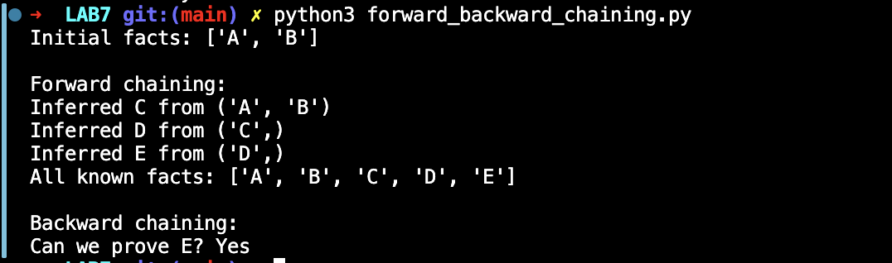

# Lab 7 — Forward Chaining and Backward Chaining

## Lab Number & Title
**Lab 7:** Rule-Based Inference — Forward Chaining and Backward Chaining

---

## Aim
To implement **rule-based inference** using two reasoning strategies:
- **Forward Chaining** (data-driven, bottom-up reasoning)
- **Backward Chaining** (goal-driven, top-down reasoning)

and to compare how each strategy uses the same set of facts and rules to derive or verify conclusions.

---

## Objectives
1. Represent knowledge as a set of **IF-THEN production rules** with conditions and conclusions.
2. Implement **Forward Chaining** to iteratively derive new facts until no more can be inferred.
3. Implement **Backward Chaining** to recursively verify whether a given goal can be proved from known facts.
4. Test both strategies on the same knowledge base and initial facts.
5. Compare the direction of reasoning in both approaches.

---

## Algorithm / Steps

### Forward Chaining (Data-Driven)
```
1. START
2. Initialize the facts set with the given initial facts.
3. Set changed = True.
4. While changed is True:
     a. changed = False
     b. For each rule (conditions → conclusion):
           - If all conditions are in the facts set:
                 If conclusion is NOT already in facts:
                     Add conclusion to facts
                     Print: "Inferred <conclusion> from <conditions>"
                     Set changed = True
5. Return the complete set of known facts.
6. STOP
```

### Backward Chaining (Goal-Driven)
```
1. START
2. Given a goal G:
     a. If G is already in facts → return True (goal proved).
     b. If G has been seen before (cycle detection) → return False.
     c. Add G to the "seen" set.
     d. For each rule whose conclusion == G:
           - Recursively try to prove ALL conditions of that rule.
           - If all conditions are provable → return True.
3. If no rule proves G → return False.
4. STOP
```

**Knowledge Base Used:**
```
Rule 1: A ∧ B → C
Rule 2: C → D
Rule 3: D → E
```

---

## Source Code

### File: `forward_backward_chaining.py`

```python
"""Lab 7: Forward and backward chaining with simple propositional rules."""


# Each rule is (conditions, conclusion).
RULES = [
    (("A", "B"), "C"),
    (("C",),     "D"),
    (("D",),     "E"),
]


def forward_chaining(initial_facts, rules):
    facts   = set(initial_facts)
    changed = True

    while changed:
        changed = False
        for conditions, conclusion in rules:
            if all(condition in facts for condition in conditions):
                if conclusion not in facts:
                    facts.add(conclusion)
                    print(f"Inferred {conclusion} from {conditions}")
                    changed = True
    return facts


def backward_chaining(goal, facts, rules, seen=None):
    """Return True if the goal can be proved from facts and rules."""
    if goal in facts:
        return True
    if seen is None:
        seen = set()
    if goal in seen:
        return False
    seen.add(goal)

    for conditions, conclusion in rules:
        if conclusion == goal:
            if all(backward_chaining(condition, facts, rules, seen.copy())
                   for condition in conditions):
                return True
    return False


def main():
    facts = {"A", "B"}
    print("Initial facts:", sorted(facts))

    print("\nForward chaining:")
    derived_facts = forward_chaining(facts, RULES)
    print("All known facts:", sorted(derived_facts))

    print("\nBackward chaining:")
    goal      = "E"
    can_prove = backward_chaining(goal, facts, RULES)
    print(f"Can we prove {goal}? {'Yes' if can_prove else 'No'}")


if __name__ == "__main__":
    main()
```

---

## Output Screenshots

### Forward and Backward Chaining Output



---

## Result & Conclusion

**Sample Output:**
```
Initial facts: ['A', 'B']

Forward chaining:
Inferred C from ('A', 'B')
Inferred D from ('C',)
Inferred E from ('D',)
All known facts: ['A', 'B', 'C', 'D', 'E']

Backward chaining:
Can we prove E? Yes
```

**Result:**  
- **Forward Chaining:** Starting from facts `{A, B}`, the engine iteratively fires rules in order:  
  - Rule 1: A ∧ B → infers C  
  - Rule 2: C → infers D  
  - Rule 3: D → infers E  
  - Final knowledge base: `{A, B, C, D, E}`
- **Backward Chaining:** Starting from goal `E`, the engine recursively traces back:  
  - To prove E, need D (Rule 3) → to prove D, need C (Rule 2) → to prove C, need A and B (Rule 1) → A and B are in initial facts → **Goal proved: Yes**

**Conclusion:**  
Forward Chaining and Backward Chaining are two complementary inference strategies in rule-based expert systems.  
- **Forward Chaining** is efficient when all initial facts are known and you want to discover what conclusions can be drawn (e.g., medical diagnosis from symptoms).  
- **Backward Chaining** is efficient when you have a specific goal and want to verify or find what evidence supports it (e.g., Prolog, legal reasoning).  
Both rely on the same underlying knowledge base; they differ only in the direction of reasoning.

---

## How to Run

```bash
python forward_backward_chaining.py
```

> **Requirements:** Python 3.9+ (standard library only — no external packages needed)
